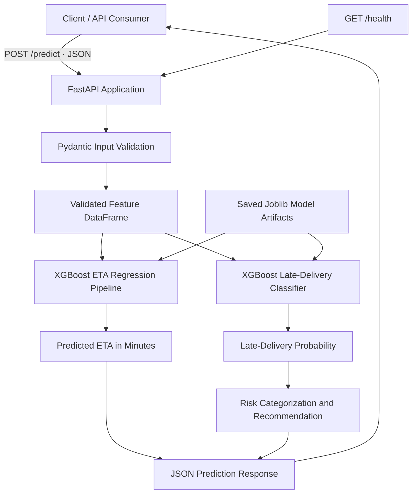

# AI-Powered Last-Mile Delivery Intelligence

An end-to-end machine learning project that predicts delivery time and assesses late-delivery risk using delivery, traffic, weather, vehicle, and location-related features.

## Project Overview

Last-mile delivery operations face challenges such as traffic congestion, changing weather conditions, and varying delivery distances. These factors can affect delivery times and make it difficult to identify orders that may arrive late.

This project develops a machine learning solution with two complementary capabilities:

- **Delivery ETA Prediction:** Estimates delivery duration in minutes.
- **Late-Delivery Risk Assessment:** Predicts the probability of a late delivery and assigns a risk category with a corresponding recommendation.

The trained models are served through a FastAPI application.

## Objectives

- Predict delivery duration using historical delivery data.
- Estimate the probability of late delivery.
- Categorize deliveries into low-, medium-, and high-risk levels.
- Provide recommendations based on predicted risk.
- Expose model predictions through a REST API.
- Validate API predictions against the original notebook pipelines.

## Machine Learning Approach

### 1. ETA Prediction

A regression model predicts delivery duration in minutes.

The project uses an XGBoost regression pipeline with preprocessing included in the saved model artifact.

**Validation results:**

| Metric | Result |
|---|---:|
| Mean Absolute Error (MAE) | 3.144 minutes |
| Root Mean Squared Error (RMSE) | 3.968 minutes |
| R² Score | 0.820 |

These results are from the validation set used during model development.

### 2. Late-Delivery Classification

A classification model estimates the probability of late delivery.

The project defines a late delivery as a delivery taking **30 minutes or longer**. This is a project-defined threshold.

**Validation results:**

| Metric | Result |
|---|---:|
| Accuracy | 0.922 |
| Precision | 0.919 |
| Recall | 0.818 |
| F1 Score | 0.865 |
| ROC-AUC | 0.980 |
| PR-AUC | 0.962 |

These metrics describe performance on the validation set, not guaranteed performance on future deliveries.

### 3. Risk Categorization

The API maps the predicted late-delivery probability to a risk category using the current project rules:

| Late Probability | Risk Level | Recommendation |
|---|---|---|
| Below 0.30 | Low Risk | Normal monitoring |
| 0.30 to below 0.60 | Medium Risk | Monitor delivery closely |
| 0.60 or above | High Risk | Prioritize intervention |

These cutoffs are configurable business rules and should not be interpreted as proven optimal intervention thresholds.

## Features

The prediction pipeline uses engineered features and delivery attributes, including:

- Delivery-person age and ratings
- Restaurant and delivery location coordinates
- Delivery distance and distance category
- Pickup hour, minute, and day of week
- Weekend, time-period, and peak-pickup indicators
- Weather conditions and road traffic density
- Vehicle condition and vehicle type
- Order type and number of multiple deliveries
- Festival indicator and city category

The API expects the feature values required by the trained pipelines. It does not currently calculate all these features from raw order timestamps or addresses.

## Technology Stack

- Python
- Pandas and NumPy
- Scikit-learn
- XGBoost
- SHAP
- Joblib
- FastAPI
- Pydantic
- Uvicorn
- Pytest
- Jupyter Notebook

## System Architecture



The FastAPI application loads both trained model pipelines from the
`models/` directory at startup. For prediction requests, it validates
the engineered input features, generates the ETA and late-delivery
probability, and returns a JSON response containing the predictions,
risk level, and recommendation.

## Project Structure

```text
ML_Project1/
├── api/
│   └── app.py
├── models/
│   ├── eta_model.joblib
│   └── late_delivery_classifier.joblib
├── tests/
│   └── test_app.py
├── notebooks/
│   └── model development notebooks
├── requirements.txt
├── .gitignore
└── README.md
```

The notebook folder name and contents should reflect the actual files in your repository.

## Installation and Setup

### Prerequisites

- Python installed
- Git, if cloning the repository

### 1. Create and activate a virtual environment

Windows PowerShell:

```powershell
python -m venv .venv
.\.venv\Scripts\Activate.ps1
```

### 2. Install dependencies

```bash
python -m pip install -r requirements.txt
```

### 3. Check model artifacts

Ensure these files are present:

```text
models/eta_model.joblib
models/late_delivery_classifier.joblib
```

The API loads these trained pipelines at application startup.

### 4. Start the API

Run from the project root:

```bash
uvicorn api.app:app --reload
```

### 5. Open the API documentation

Visit:

```text
http://127.0.0.1:8000/docs
```

The Swagger interface allows you to submit prediction requests and inspect API responses.

## API Endpoints

### Health Check

**Method:** `GET`

**Endpoint:** `/health`

Checks application health and whether both model objects are loaded.

Example response:

```json
{
  "status": "healthy",
  "eta_model_loaded": true,
  "classifier_loaded": true
}
```

### Delivery Prediction

**Method:** `POST`

**Endpoint:** `/predict`

Accepts the engineered delivery features and returns an ETA prediction, late-delivery probability, risk category, and recommendation.

The request must include all required fields defined by the `DeliveryFeatures` schema in `api/app.py`.

Example response:

```json
{
  "predicted_eta_minutes": 37.5857315063,
  "late_probability": 0.9978383183,
  "risk_level": "High Risk",
  "recommendation": "Prioritize intervention"
}
```

The numerical values above are an example from a tested validation row, not a fixed response for every request.

## Testing

The project includes automated API tests for:

- Health endpoint behavior
- Valid prediction requests
- Invalid pickup-hour validation
- Missing required fields

Run the tests from the project root:

```bash
python -m pytest tests/test_app.py -v
```

The API's predictions were also compared with notebook predictions on three validation examples. The ETA and late-delivery probabilities matched for those examples.

## Model Interpretation

The project includes SHAP-based analysis to investigate which features influence model predictions.

Feature importance and local explanations can help examine model behavior, but they do not establish causation.

## Limitations

- Predictions depend on the quality and representativeness of historical data.
- The late-delivery definition and risk cutoffs are project assumptions.
- The current API expects engineered feature values rather than raw order information.
- Validation performance may differ from real-world production performance.
- The model has not been established as a live production system.

## Future Improvements

- Build a preprocessing service that accepts raw order information and calculates engineered features.
- Add broader automated tests and structured logging.
- Evaluate risk thresholds against operational costs and intervention outcomes.
- Deploy the API to a suitable hosting platform.
- Monitor prediction quality and data drift when real operational data becomes available.

## Project Summary

This project combines machine learning, model evaluation, model persistence, API development, input validation, and automated testing into an end-to-end delivery intelligence workflow.
